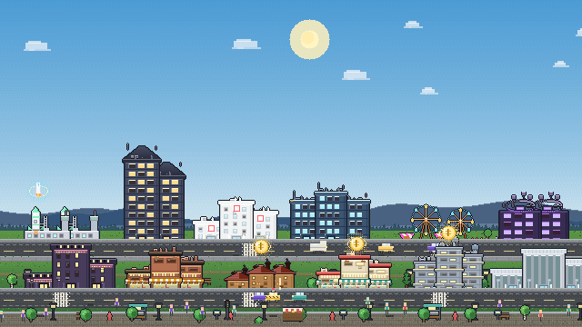
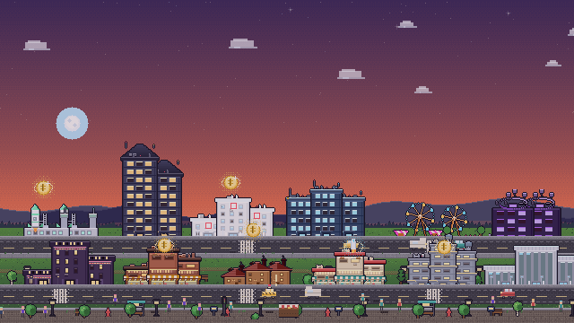
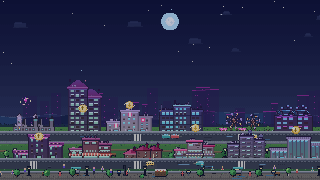

# 🏙️ PixCity

**Un idle city-builder pixel-art, complet et jouable dans le navigateur.**
Tu tapes, tu construis, ta ville produit en continu — et ça devient vite incontrôlable
(dans le bon sens du terme).

> ⚠️ **Les achats in-game sont SIMULÉS.**
> Le bouton « Payer » joue tout le tunnel d'un vrai achat (connexion, commande, paiement,
> reçu, validation) et affiche « ACHAT VALIDÉ », mais **rien n'est débité**, aucune donnée
> bancaire n'est demandée et rien ne quitte ton appareil. C'est une démo gratuite.

---

## 🚀 Lancer le jeu

```bash
npm start          # → http://localhost:5173
```

Aucune dépendance à installer : c'est du HTML/CSS/JS natif (ES modules).
N'importe quel serveur statique fait l'affaire :

```bash
python3 -m http.server 5173
```

### Autres commandes

| Commande | Effet |
|---|---|
| `npm start` | Serveur de dev (zéro dépendance, `0.0.0.0:5173`) |
| `npm test` | **190 tests** : économie, sauvegarde, achat simulé, UI, cohérence visuelle, démarrage réel |
| `npm run preview` | Rend le pixel-art en PNG (bâtiments, décors) |
| `node tools/preview.mjs 2 --sheet` | Planche de tous les bâtiments à un palier (PNG) |
| `node tools/city.mjs late` | Rend la scène complète à un stade de jeu (PNG) — `--phase=0..3` fige l'heure, `--crop=x,y,w,h[,zoom]` recadre |
| `node tools/zoom.mjs cabane,cafe 3 4` | Loupe ×N sur quelques bâtiments (« est-ce que ça tient à l'écran ? ») |
| `node tools/icons.mjs` | Régénère les icônes PWA |

---

## 🎮 Le jeu

**Boucle principale :** tape la ville → pièces → bâtiments → revenus/seconde → nouveaux
bâtiments → **prestige** → étoiles permanentes → on recommence, plus vite, plus fort.

| Système | Détail |
|---|---|
| 👆 **Tap & combo** | Chaque tap rapporte une base **+ 5 % des revenus/s**. En tapant vite, le combo monte jusqu'à **×3** (×8 avec l'amélioration « Fièvre du tap »). |
| 🏗️ **12 bâtiments** | De la Cabane au **Quartier Quantique**. Prix ×1,115 par unité, achats ×1 / ×10 / ×100 / **MAX**. |
| 🎚️ **Paliers** | Tous les **25** bâtiments : production **×2** et visuel qui évolue (jusqu'à des gratte-ciel). |
| 💰 **Bonus à collecter** | Des bulles apparaissent au-dessus des bâtiments : pièces, gemmes 💎, ou boost de production. |
| 🚕 **Taxi doré** | Traverse la ville de temps en temps : pièces, gemmes ou **×7 pendant 100 s**. |
| 💎 **Bonus permanents** | 6 améliorations à niveaux + 6 améliorations uniques (veilleuse hors-ligne, robots tapoteurs, skin néon…). |
| 📋 **Quêtes** | 15 quêtes principales + **3 défis du jour** régénérés chaque jour + série de jours. |
| 🏆 **25 succès** | Récompensés automatiquement en gemmes. |
| 🌙 **Hors-ligne** | La ville produit pendant ton absence (plafond 2 h → 24 h avec la Veilleuse). |
| 🌟 **Prestige** | +10 % de production par étoile, pour toujours. |
| 🕐 **Cycle jour/nuit** | 7 minutes : aube, jour, crépuscule, nuit étoilée. |
| 🔊 **Son & musique** | 100 % synthétisés en WebAudio (aucun fichier audio). |

### Tout est dessiné « à la main », en code

Aucun sprite externe : chaque bâtiment est **procédural** (recette pixel-art → framebuffer →
canvas). Le même code de dessin tourne dans le navigateur *et* en Node, ce qui permet de
générer des PNG de contrôle sans navigateur.

```
src/gfx/fb.js        framebuffer Uint32RGB, primitives + encodeur PNG
src/gfx/sprites.js   recettes des 12 bâtiments + décors (arbres, lampadaires, bancs…)
src/gfx/city.js      la scène : ciel, collines, routes, parcelles, passants, effets
src/gfx/surface.js   abstraction canvas/framebuffer (même code de rendu partout)
```

**Passe graphique (rendu en jeu)** — le look « 16-bit » tient à quatre recettes :

- **tramage Bayer 4×4** (`BAYER4`, `ditherRect`, `paintVerticalGradient`) : plus de dégradés
  lisses — le ciel, l'herbe et les trottoirs sont peints en bandes quantifiées avec des
  transitions tramées, comme sur une console 16 bits ;
- **contours de silhouette** (`outlineSilhouette`) sur chaque bâtiment et chaque décor :
  la ville se détache du ciel et reste lisible en miniature ;
- **halos tramés** (`drawGlow`, `drawBubble`, lampadaires, phares, néons) : la lumière chaude
  est posée en pixels épars, jamais en aplat flou ;
- **cache de calques + cache du ciel** (`layer()`, `_skyCache`) : le décor immuable (collines,
  routes, trottoirs, pavés) est cuit une fois hors-écran, donc la scène reste fluide sur mobile.

Captures générées par les outils (aucune capture d'écran, tout est rendu par le code de dessin) :

| Jour | Crépuscule | Nuit néon |
|---|---|---|
|  |  |  |

*(`node tools/city.mjs late --noneon --phase=1`, `--phase=2`, puis `late --phase=3`.)*

---

## 🛒 La boutique (achats simulés)

Packs disponibles (aucun n'est payant en démo) :

| Pack | Prix fictif | Contenu |
|---|---|---|
| 🎁 Pack Fondateur | 2,99 € | 400 💎 + production ×2 + skin Néon + badge |
| 💎 Poignée / Sac / Coffre / Banque de gemmes | 4,99 → 49,99 € | 500 → 11 000 gemmes |
| 👑 Pass VIP | 9,99 € | ×2 permanent, +250 💎/jour, badge |
| 🧘 Pack Zen | 3,99 € | Supprime les offres flash, pubs ×2 |

Il y a aussi des **offres flash** (-40 / -60 %, avec compte à rebours) et une **pub
récompensée simulée** (5 s → +25 💎, toutes les 2 min).

### Comment ça marche

Tout est local, dans `src/app/backend.js` : `connect()` → `createOrder()` → `pay()` →
`validate()` → reçu sauvegardé dans le navigateur. Latences simulées, écran de reçu,
historique consultable (**touche `R`**).

**Pour passer en production**, il faut remplacer ces méthodes par de vrais appels serveur
(Stripe, Google Play Billing, App Store) **et valider les reçus côté serveur** — la
validation doit toujours être faite par le serveur, jamais par le client.

---

## 🎨 Identité visuelle (workflow des images)

Toutes les illustrations du jeu partagent **une seule identité visuelle**, figée dans
[`docs/ARTSTYLE.md`](docs/ARTSTYLE.md).

**La règle :** un unique *prompt maître* décrit le style, la palette (13 couleurs
officielles), la lumière et les interdits. Pour chaque image, **une seule ligne change** :
`SUBJECT: …`. On ne touche jamais au style.

```bash
npm run art:check   # audit : palette, lumière chaude, monde froid, luminosité
npm run art         # masters → dérivés web (réduction + quantification)
```

Ce qui est versionné :

| Dossier | Rôle | Poids |
|---|---|---|
| `assets/art/*.png` | **masters** générés par IA avec le prompt maître (jamais modifiés) | 8,8 Mo |
| `assets/art/web/*.png` | dérivés utilisés par le jeu, PNG indexé 256 couleurs | 1,4 Mo |
| `assets/icons/*.png` | icônes PWA, dérivées de `art/icon.png` | 130 Ko |
| `assets/art/PROMPT.txt` | le prompt maître, prêt à copier-coller | — |

**Comment les images sont fabriquées.** Les modèles d'image ne savent pas produire du vrai
pixel-art : ils génèrent une illustration de style pixel-art, avec des dizaines de milliers
de couleurs. La chaîne maison fait le reste :

1. génération avec le prompt maître (+ les masters déjà validés en référence) ;
2. **audit automatique** (`artcheck.mjs`) : chaque image est décodée par un lecteur PNG
   écrit à la main, puis notée sur la palette officielle, la part de lumière chaude, la
   part de monde froid et la luminosité ;
3. réduction par moyenne de blocs puis **quantification 256 couleurs** — les couleurs
   officielles sont toujours conservées ;
4. écriture d'un **PNG indexé compressé par notre propre DEFLATE** (`src/gfx/deflate.js`,
   LZ77 + Huffman fixe, validé par zlib) : 8,8 Mo de masters deviennent 1,4 Mo.

> Les tests (`npm test`, section « Cohérence visuelle des assets ») refusent tout asset qui
> sortirait de la palette, qui deviendrait trop lumineux, ou qui perdrait le monde froid
> indigo/navy — l'ADN visuel de PixCity.

**Journal du style.** La v1 est née d'un premier jet où le style, la palette et la lumière
étaient déjà justes, mais où les sujets dérivaient vers le médiéval (« tower » → château).
La v1.1 a ajouté au prompt maître un bloc `PIXCITY LOOK` (gratte-ciel modernes, néons,
rues asphaltées) et une interdiction explicite du médiéval. Leçon : la dérive vient du
**sujet**, jamais du style.

## 🗂️ Architecture

```
index.html            écran unique : boot, scène, HUD, panneaux, modales
docs/ARTSTYLE.md      identité visuelle : prompt maître, palette, workflow
assets/art/           masters IA + dérivés web + PROMPT.txt
src/gfx/deflate.js    compresseur DEFLATE maison (PNG légers, zéro dépendance)
styles/
  base.css            kit d'UI pixel-art (boutons, panneaux, modales, toasts)
  game.css            écrans de jeu (HUD, dock, boutique, tunnel de paiement…)
src/
  core/               moteur pur, sans DOM (testable en Node)
    data.js           tous les chiffres du jeu (bâtiments, packs, défis)
    economy.js        coûts, production, multiplicateurs, prestige
    state.js          état sérialisable + migration de sauvegarde
    save.js           sauvegarde locale, export/import, gains hors-ligne
    quests.js         quêtes principales, défis du jour, série
    achievements.js   25 succès
    iap.js            définition des packs + effets (paiement = simulé)
    audio.js          SFX & musique WebAudio
    bus.js, format.js utilitaires
  gfx/                moteur pixel-art (voir plus haut) + encodeur PNG/DEFLATE
  ui/art.js           chargement paresseux des illustrations d'identité
  ui/                 interface : hud, panels, modales, tunnel de paiement, tutoriel
  app/
    game.js           orchestrateur : boucle, caméra, actions, sauvegarde auto
    backend.js        « boutique » simulée
    main.js           point d'entrée, entrées tactiles/clavier
tools/
  serve.mjs           serveur statique de dev
  test.mjs            190 tests (économie, UI, achat simulé, visuel, démarrage réel)
  domstub.mjs         DOM minimal pour tester le jeu sans navigateur
  preview.mjs/city.mjs/zoom.mjs    générateurs d'images de contrôle
  icons.mjs            icônes PWA (depuis assets/art)
```

### Sauvegarde

Locale (`localStorage`, clé `pixcity.save.v1`), autosave toutes les 8 s et à chaque achat.
Export/import en base64 dans **⚙️ → Sauvegarde**. Si le stockage est indisponible
(iframe restreinte), le jeu bascule automatiquement sur une sauvegarde en mémoire.

---

## 🎛️ Contrôles

| Action | Tactile | Clavier |
|---|---|---|
| Taper / gagner | 1 doigt | `Espace` |
| Se déplacer | glisser | glisser |
| Bâtir / Bonus / Boutique | dock | `B` / `U` / `S` |
| Quêtes / Succès | dock | `Q` / `A` |
| Prestige | dock 🌟 | `P` |
| Fermer un panneau | taper la ville | `Échap` |
| Historique d'achats | — | `R` |

---

## 📈 Équilibrage (mesuré par les tests)

Simulation d'un joueur actif (1,3 tap/s au début, achats optimisés) :

| Bâtiment | Débloqué à |
|---|---|
| 🛖 Cabane | immédiat |
| 🏪 Épicerie | 1 min |
| ☕ Café | 5 min |
| 🏢 Immeuble | 14 min |
| 🎬 Cinéma | 26 min |
| 🏬 Centre Commercial | 43 min |
| 🏥 Hôpital | 1 h 05 |
| 🏙️ Tour de Bureaux | 1 h 32 |
| 🌆 Gratte-ciel | 2 h 07 |
| 🎡 Parc d'Attractions | 2 h 50 |
| 🚀 Gare Spatiale / 🔮 Quartier Quantique | plusieurs sessions + prestiges |

---

## 💡 Notes

- Jeu **hors-ligne d'abord** : aucun compte, aucun serveur, aucune télémétrie.
- Le filtre CRT, les particules et les secousses sont désactivables (⚙️).
- Installable en PWA (manifest + service worker), jouable en plein écran sur mobile.
- Sauvegarde automatique : tu peux fermer l'onglet, ta ville continue de produire.

Fait à la main, pixels compris 💛
